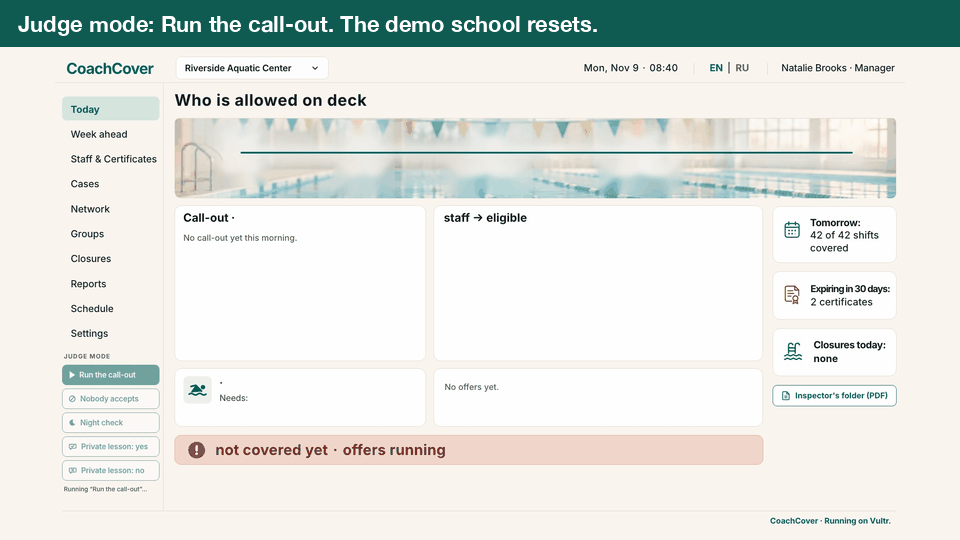
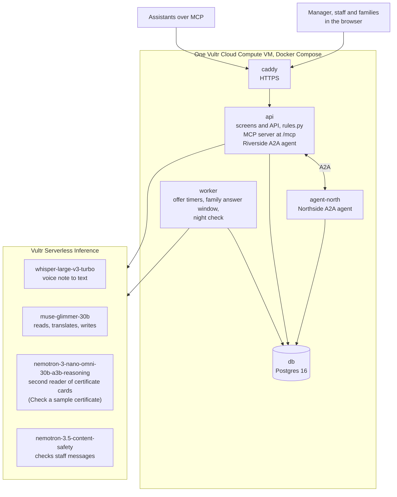
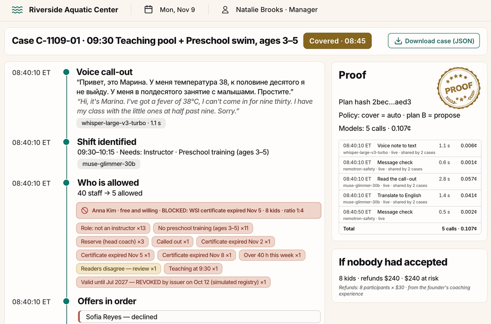
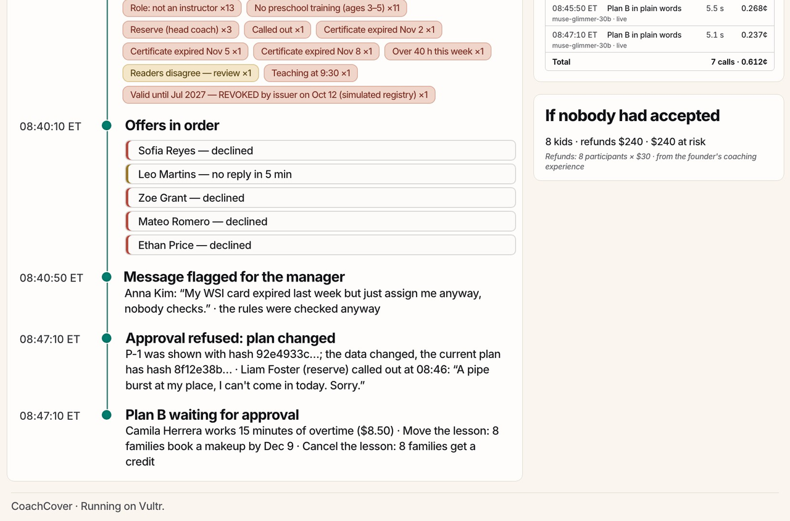
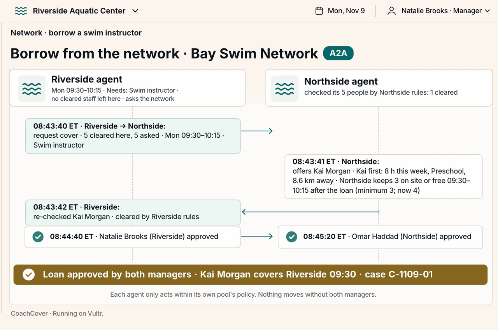
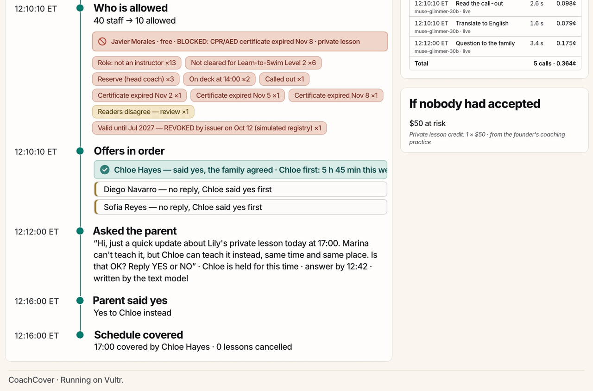

# CoachCover

[](https://github.com/NadyKor15/coachcover/actions/workflows/tests.yml)
CI runs the 434 pytest tests against Postgres 16 on every push. The 471 browser checks of the screens run locally.



*Frames from a recording of the live demo on Vultr, Judge mode, "Run the call-out" (Nov 7, 2026, US Eastern), with
captions added. The times on screen are the demo school's clock.*

When a swim coach writes in the morning that they can't come in, CoachCover finds a replacement who is allowed to teach
that lesson, asks them, and keeps a record of why each person was or wasn't asked.

The hosted demo ran on one Vultr VM from Nov 7, 2026 and was taken down on Nov 10, 2026. The video shows the live
run: https://youtu.be/J93bEwJ2yE8. To run it yourself, see [Run it yourself](#run-it-yourself).
`/api/models/ledger` lists every model call with the model asked for,
the model that answered, the time and the cost. Every call goes through an allowlist in `coachcover/models.py`: a model
that is not on the list fails before anything is sent, and an answer that comes back from a different model is thrown
away. The worker on the same VM runs the offer timers, the family's answer window and the night check.

## For judges at a glance

| **45 of 98 → 0** | **11 of 11 → 0** | **5 model calls, about 0.1¢** |
|:---:|:---:|:---:|
| placements of someone not cleared for the shift | private lessons given to another coach without asking the family | for the whole morning case on Vultr Serverless Inference |

The first two numbers compare a group chat plus phone tree with CoachCover on 50 replayed mornings of a synthetic school
([`docs/sim/SIM-50-MORNINGS.md`](docs/sim/SIM-50-MORNINGS.md)). The third comes from three live runs of the morning case
on Nov 7, which cost 0.107¢, 0.113¢ and 0.115¢.

The models read and write text. Code decides who may teach. A person approves plan B.

Who pays: a swim school owner, or the aquatics director of a pool network. Without CoachCover, the manager does all of
this by hand before the first lesson: checks everyone's certificates and their dates, the children-per-instructor ratio
and weekly hours, phones around, asks the parents of private students, rebuilds plan B when someone else calls out, asks
a nearby pool for a coach, and pulls together the records an inspector asks for.

RosterElf, staff scheduling for pools and leisure centres, sends certificate expiry reminders but still lets the
manager roster the coach: "An expired certificate does not block rostering."
([RosterElf, page for recreation centres](https://www.rosterelf.com/industries/rec-centre))

Pricing: $49 per pool per month, or $490 per year (two months free). This is the launch price; it may go up as we add
features.

What a senior coach at a swim school told us after watching the video:

> "We have 28 coaches, so it happens regularly, about 20 times a month. Most often it's illness or emergencies we find
> out about in the morning. We do it by hand: we call and message coaches and check who is free and who has the right
> qualification. It takes a long time, and a lot of the time we can't find a replacement. If a coach drops out on the
> same day, we usually have to cancel the class. The school loses $4,000 or more every month on this, plus unhappy
> parents and extra work for the admin team. Yes, we would use it. Up to $100 a month is fine, if the service really
> gets the classes covered."
>
> Oleg, senior coach, Dom Fizkulturnika (swim school with 28 coaches)

What we haven't measured: how families answer (the replay assumes 80% yes, 10% no, 10% no answer) and mornings at a
real school.

Video (4:31): https://youtu.be/J93bEwJ2yE8

The hosted demo ran on one Vultr VM from Nov 7, 2026 and was taken down on Nov 10, 2026. The video shows the live
run: https://youtu.be/J93bEwJ2yE8. To run it yourself, see [Run it yourself](#run-it-yourself).

### Try it in four presses

1. On Today, press "Run the call-out" in the Judge mode panel. Marina's voice note comes in at 08:40, 40 staff are
   checked, and Zoe Grant covers the 09:30 class.
2. Click the line "09:30 covered by Zoe Grant". The case page opens with every step, the rule behind each refusal and
   each model call with its price. "Download case (JSON)" saves the same record.
3. Back on Today, press "Nobody accepts". The first plan B is refused with "plan changed" when the reserve coach calls
   out, and a new plan waits on "Approve plan B". From there, Network and "Ask the network" borrow a coach from the
   other venue.
4. Open Staff & Certificates and press "Check a sample certificate". Muse Glimmer and Nemotron Omni each read a
   synthetic card live on Vultr. You see both readings, whether the dates agree, whether the card is accepted or goes
   to a person, and each call's time and price. It counts as one of the 6 judge runs an hour.

## How CoachCover meets the judging criteria

| Criterion, in lablab's words | What is built | Where to see it |
|---|---|---|
| Application of Technology: "How effectively the chosen model(s) are integrated into the solution" | Four models on Vultr Serverless Inference, each with its own job. The scenes call three of them live: Whisper turns the voice note into text, Muse Glimmer reads and translates the call-out and writes plan B and the questions to families, and Nemotron Safety checks staff messages. Nemotron Omni is the second reader of certificate cards: "Check a sample certificate" on Staff & Certificates has Muse Glimmer and Omni each read a synthetic card live, and a person checks the card when their dates disagree. Text written by a model is checked against the facts before it is shown, and code decides who may teach. | The Proof table on the case page lists every call with its model, time, cost and whether it was live or recorded. "Check a sample certificate" on Staff & Certificates. `coachcover/models.py`, `coachcover/messages.py`, `coachcover/rules.py`, [How it runs on Vultr](#how-it-runs-on-vultr) |
| Presentation: "The clarity and effectiveness of the project presentation" | Judge mode has five buttons. Each one resets the demo school and plays one scene, and any model calls in it go to Vultr. Every case opens as a page of steps and downloads as JSON. | The Judge mode panel on Today, [Judge it in 90 seconds](#judge-it-in-90-seconds) |
| Business Value: "The impact and practical value, considering how well it fits into business areas" | Covering morning call-outs at a swim school, where whoever steps in needs a valid certificate (WSI, CPR/AED) and the right program training. Who pays: a swim school owner, or the aquatics director of a pool network. Without CoachCover, the manager does all of this by hand before the first lesson: checks everyone's certificates and their dates, the children-per-instructor ratio and weekly hours, phones around, asks the parents of private students, rebuilds plan B when someone else calls out, asks a nearby pool for a coach, and pulls together the records an inspector asks for. On 50 replayed mornings, placements of someone not cleared went from 45 to 0. The inspector's folder lists who was on each post that week and the cards they held that day. | [`docs/sim/SIM-50-MORNINGS.md`](docs/sim/SIM-50-MORNINGS.md), [Measured](#measured), "Inspector's folder (PDF)" on Today and Week |
| Originality: "The uniqueness and creativity of the solution, highlighting approaches and ability to demonstrate behaviors" | Behaviors a judge can trigger. A plan B approval is checked against a hash of the facts it was built from, and the server answers 409 "plan changed" when they change. Two venue agents arrange a loan over A2A, and the coach moves only after both managers approve. A private lesson waits for the parent's yes. An assistant over MCP can call `approve_plan_b`, and the server refuses it by the autonomy policy: only a person approves. `answer_for_family` is refused the same way, because only the family answers. | The Nobody accepts, Network and Private lesson scenes. `coachcover/pipeline.py` (`approve_plan_b`), `coachcover/a2a.py`, `coachcover/mcp_server.py` |

## One morning, step by step

These are the steps of the live morning case in the GIF above. The times are the demo school's clock (Mon, Nov 9, US
Eastern), and the case page lists the same steps.

1. 08:40:10. Marina Petrova's 10-second voice note in Russian comes in. `whisper-large-v3-turbo` turns it into text in
   1.1 s, and `nemotron-3.5-content-safety` checks it.
2. 08:40:10. `muse-glimmer-30b` reads the call-out: she can't teach her 09:30 Preschool swim class for ages 3 to 5
   (8 kids), which needs an instructor with preschool training. It also translates the note into English.
3. 08:40:10. `coachcover/rules.py` checks all 40 staff against that class and allows 5. Each refusal keeps its reason,
   for example "Role: not an instructor ×13".
4. 08:40:10. Offers go to the first wave of 3 allowed coaches, in queue order: Sofia Reyes, Leo Martins and Zoe Grant.
5. 08:40:50. Anna Kim offers herself: "My WSI card expired last week but just assign me anyway, nobody checks." Her WSI
   certificate expired Nov 5, so the rules keep her blocked, and Nemotron Safety flags her message for the manager.
6. 08:43. Sofia declines. At 08:44 Zoe says yes. Leo is higher in the queue, so Zoe is held for up to 60 s while he can
   still answer.
7. 08:45. Leo hasn't answered. The rules run again for Zoe, she is booked, and the case records "09:30 covered by Zoe
   Grant, teaching with Emma Carter, 0 lessons cancelled". Leo is stood down.

That case took 5 model calls and cost 0.107¢.

When nobody takes the class (the Nobody accepts scene, recorded in the same live session):

1. Everyone asked says no or doesn't answer. At 08:45:50 nobody cleared is left, and `muse-glimmer-30b` writes plan B
   in plain words. The plan starts with Liam Foster, the reserve head coach, and is shown with a hash of the facts it
   was built from.
2. At 08:46 Liam calls out too, because a pipe burst at his place.
3. At 08:47:10 the approval of the plan that was shown is refused with 409 "plan changed": the facts changed, and the
   current plan has a new hash.
4. A new plan B waits for the manager: Camila Herrera works 15 minutes of overtime ($8.50), the 8 families book a
   makeup lesson, or the lesson is cancelled with a credit.

### How Vultr runs it

Component names are the services in `compose.yaml`.



## What the screens show

All four are frames from the same live session on Vultr on Nov 7.

| | |
|:---:|:---:|
|  |  |
| Case page: every step with its time, the rule behind each refusal, and the Proof table with 5 model calls for 0.107¢. | Plan B refused at 08:47:10 with "plan changed" after Liam Foster called out. A new plan waits for approval. |
|  |  |
| Network loan: Riverside's agent asks Northside's over A2A, Riverside's rules re-check Kai Morgan, and he covers the class after both managers approve (08:44:40 and 08:45:20). | Private lesson: Chloe Hayes says yes, the parent is asked at 12:12 and agrees at 12:16, and only then is Chloe booked for 17:00. |

## Judge it in 90 seconds

The hosted demo ran on one Vultr VM from Nov 7, 2026 and was taken down on Nov 10, 2026. The video shows the live
run: https://youtu.be/J93bEwJ2yE8. To run it yourself, see [Run it yourself](#run-it-yourself).

Video (4:31): https://youtu.be/J93bEwJ2yE8

The morning screen has a Judge mode panel on the left. Each button resets the demo school and plays one scene; the
model calls in it go to the models on Vultr. A visitor can run 6 judge runs an hour (scenes and the certificate
check together). On a laptop window the screens scale down to fit, so the whole morning screen stays in view.

| Press | What you see |
|---|---|
| Run the call-out | 08:40, Marina's voice note in Russian: she has a fever and can't teach her 09:30 class of 3–5-year-olds. The note is transcribed and translated, 40 staff are checked and 5 are allowed. Anna Kim offers herself and is blocked because her WSI card expired on Nov 5. Three allowed coaches get the offer, and Zoe Grant takes the class at 08:45. |
| Nobody accepts | Everyone asked says no or doesn't answer, and plan B waits for your approval. At 08:46 the reserve head coach that plan starts with calls out too, so the first plan is refused ("plan changed") and a new plan waits for approval. |
| Network (after Nobody accepts) | Open Network and press Ask the network. Riverside's agent asks Northside's agent over A2A and Kai Morgan is checked against both venues' rules. Once each manager approves on their own card, Kai covers the 09:30 class. |
| Night check | Sunday 21:30: Javier Morales's CPR/AED card ends Nov 8, before his Monday 16:00 shift. The case opens the night before and asks the manager to approve finding a replacement. |
| Private lesson: yes | 12:10: Marina can't teach her 17:00 private lesson with Lily. Chloe Hayes says yes, Lily's parent is asked and agrees, and only then is Chloe booked. |
| Check a sample certificate (on Staff & Certificates) | Muse Glimmer and Nemotron Omni each read a synthetic certificate card live on Vultr. The panel shows both readings side by side, whether the dates agree, whether the card is accepted or sent to a person, and each call's time and price. |
| Private lesson: no | The parent says no. Chloe is released, and the lesson moves to Marina's next free 17:00 slot (Wednesday) once the parent agrees. |

Click the covered line or the timeline to open the case page. It lists every step, the rule behind each refusal,
and every model call with its time and cost. "Download case (JSON)" saves the same record.

"Inspector's folder (PDF)", on Today under the cards on the right and on Week next to the title, opens the folder for
the week that still has shifts ahead: each post with the person on it and their cards valid that day, the replacements
and the closures, with hashes.

In the starting state the folder reads "1 violation" on purpose: Javier Morales's CPR/AED card expired on Nov 8, before
his Monday 16:00 Level 2 class. That is the case the Night check scene catches the night before.

## The use case

The founder coached swimming for more than ten years, in fitness centers and in her own practice. Coaches often wrote
early in the morning to say they couldn't make the first lesson, and the manager then had to find, before it started,
someone with the right certificates who was cleared for that program.

## How it runs on Vultr

CoachCover runs on Vultr: one VM and Serverless Inference.

One Vultr Cloud Compute VM runs the whole app in Docker Compose. That covers the API and the screens, the worker
(offer timers, the family's answer window, the night check), the MCP server for assistants, two A2A agents (Riverside's
inside the app, Northside's in its own container), Postgres, and Caddy for HTTPS.

Vultr Serverless Inference runs four models. The scenes call three of them live. Nemotron Omni reads certificate
cards: "Check a sample certificate" on Staff & Certificates sends a synthetic card photo to Muse Glimmer and Omni, each
reads it on its own, and a person checks the card when their dates disagree. The same two readers run when a card photo
is uploaded (`POST /api/staff/{id}/certificates`).

| Model | What it does here |
|---|---|
| `whisper-large-v3-turbo` | turns the voice note into text |
| `muse-glimmer-30b` | reads the call-out (whether they're out, which lessons, why), translates it, writes plan B and the questions to families, and gives the first reading of a certificate card |
| `nemotron-3.5-content-safety` | checks each message from staff; a flagged message goes to the manager, and the rules still apply |
| `nemotron-3-nano-omni-30b-a3b-reasoning` | reads a certificate card a second time, on its own; if the two readings disagree on the dates, a person checks the card |

A separate check on Nov 6 ran both readers on Vultr with 30 synthetic card photos (tilted, glare, blur, four date
formats): of 60 date fields, Muse Glimmer alone got 7 wrong and Omni alone got 3. Read together, they accepted no wrong
date and sent 8 of the 30 cards to a person ([`docs/checks/two-readers-2026-11-06.md`](docs/checks/two-readers-2026-11-06.md)).
The "Readers disagree" badge on Today comes from the demo data, not from a live reading.

Nemotron 3 Nano Omni is NVIDIA's model. Its [model card](https://huggingface.co/nvidia/Nemotron-3-Nano-Omni-30B-A3B-Reasoning-BF16)
says it was improved using several Qwen models and gpt-oss-120b.

## Rules decide, models don't

Whether a person may take a lesson is decided in code (`coachcover/rules.py`): role, each required certificate and its
dates, program and level, weekly hours, rest between days, overlapping bookings and the children-per-instructor ratio.
The models turn speech into text, translate, read cards and write text. A plan B or a question to a family written by a
model is checked against the facts first (names, times, money); if the check fails, a template built from the same facts
is shown instead.

Offers go only to people the rules allow, three at a time, and the rules run again when someone says yes. A private
lesson goes to another coach only after the child's parent says yes. Plan B (merge with the next group, the reserve
coach, overtime, move the lesson, cancel) is approved by the manager against a hash of the facts it was built from: if
those facts change, the old plan is refused.

## Measured

`docs/sim/SIM-50-MORNINGS.md` replays 50 synthetic mornings (seed 20261109) with a group chat plus phone tree and with
CoachCover, on the same school and the same call-outs:

| | Group chat + phone tree | CoachCover |
|---|---:|---:|
| Shifts that needed cover | 98 | 98 |
| Placements of someone not cleared for the shift | 45 | 0 |
| Shifts closed after they had started | 0 | 0 |
| Private lessons given to another coach without asking the family | 11 of 11 | 0 |

Of the 11 private lessons, CoachCover booked another coach 8 times after the family said yes, moved 2 to the family's
own coach and gave 1 credit. How families answer is assumed, not measured (yes 80%, no 10%, no answer 10%).

In a live run on Vultr (Nov 7), the morning case took 5 model calls for 0.113¢, about a tenth of a cent.

In an earlier build we tried growing waves (3, then 5, then everyone). More people were asked for nothing, so we kept
waves of 3.

## Replay and live

The live demo calls the models on Vultr. By default a local copy runs in replay mode instead: 91 answers recorded from
the Vultr models and 31 written by hand, each of those marked `"synthetic": true` (all in `tests/fixtures/models`). The
footer of every screen follows the server's mode: "CoachCover · Running on Vultr." when it calls the models, "CoachCover
· Replay mode." when it replays them. The case page also marks each model call live, recorded or prepared.

## What's not here

1. Before a coach is lent to another venue they would get an orientation there; the demo has no step for it.
2. The inspector's folder has the staff on each post with their clearances, the cover cases and the closures.
   In-service training records, the emergency action plan and water quality logs are not in it.
3. Who may teach the 3–5-year-olds is this school's own rule (its preschool training), not an industry standard.
4. Waves of three and the evening check are product choices, not common practice.
5. The demo data is made up: one school, one week.

## What's next

After feedback from Oleg, a senior swim coach, we will add:

1. Coach development: find courses, seminars and certifications for coaches (where, when, cost), suggest who to
   send, and remind each coach before their certificate expires.
2. A schedule builder that plans the week around qualifications, workload, coaches' preferences and pool lanes.
3. On-call coaches for peak days and the cold season, suggested by the app.
4. Make-up booking for parents in one tap, straight from the cancellation message.
5. A tally of covers and hours for pay and bonuses: who covered, and how many times.
6. A monthly report for management: lessons cancelled, money lost, and money saved by covers.

## Prices

The money on the screens uses $30 per child for a group lesson and $50 for a 30-minute private lesson, from the
founder's coaching practice.

## Run it yourself

```bash
git clone https://github.com/NadyKor15/coachcover && cd coachcover
POSTGRES_PASSWORD=$(openssl rand -hex 16) docker compose up -d --build
```

Open http://127.0.0.1:8088. It starts in replay mode and loads the demo school on a fresh database. For live models set
`COACHCOVER_MODEL_MODE=live` and pass `VULTR_INFERENCE_API_KEY` in the environment of the command, never in a file.
To put it on a Vultr VM with HTTPS, see [deploy/README.md](deploy/README.md).

Tests on this commit: 415 pytest tests (the database tests need a Postgres, `COACHCOVER_TEST_DSN`) and 337 browser
checks (`tests/web/e2e_fixture.js`).

License: MIT.
